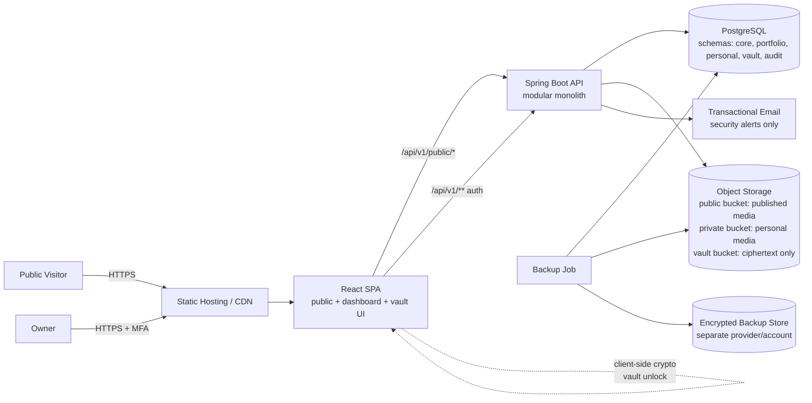
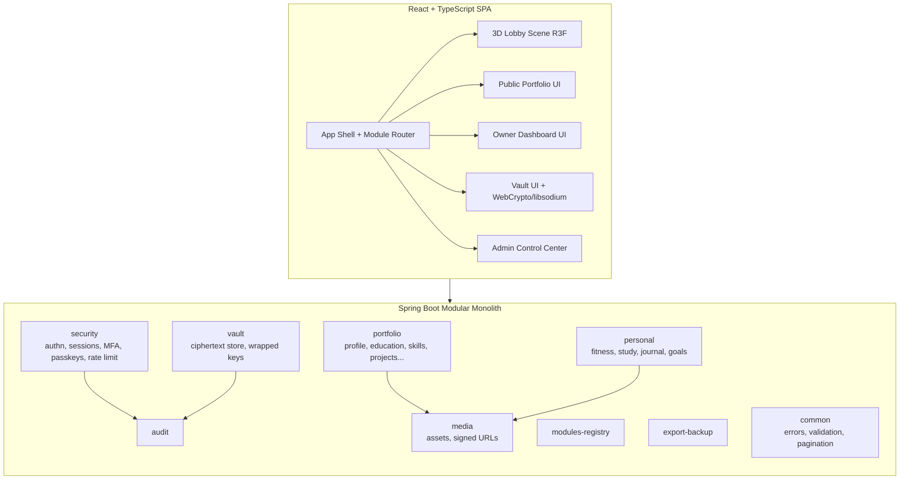

# 02 — GIRISH Technical Implementation Plan

**Status:** Draft for owner review — no code has been written.
**Source:** `GIRISH_MASTER_PROJECT_SPECIFICATION.md`
**Companion documents:** `03_PROJECT_STRUCTURE.md`, `04_SECURITY_SPECIFICATION.md`, `05_DEVELOPMENT_ROADMAP.md`

> Conventions: **[CONFIRMED]** = stated in the specification. **[ASSUMED]** = my working assumption, to be confirmed. **[OPEN]** = needs an owner decision (see Section 16). Nothing here invents personal data; profile facts in the spec are treated as draft until you confirm them.

---

## 1. Understanding of the vision

GIRISH is a long-lived personal platform with four connected experiences:

1. **Public portfolio** — recruiter-friendly, publishes only explicitly approved records.
2. **Private dashboard** — owner-only records: fitness, study, journal, goals, weekly updates.
3. **Secure vault** — a separate security boundary for confidential files and data.
4. **3D identity experience** — one consistent avatar whose outfit/pose/scene changes per module, always optional for navigation.

The defining requirement is **expandability**: modules are added over years without rebuilding the core. The architecture therefore centres on a **module registry**, a **modular monolith**, **portable data formats**, and **strict public/private separation**.

---

## 2. Requirements analysis

### 2.1 Confirmed requirements (from the spec)
- Four experiences above; dark, professional, game-lobby-inspired UI; responsive; accessible; reduced-motion support.
- Configuration-driven module registry (add/hide/reorder/rename/disable/archive); no executable plugins.
- Owner-controlled publishing; private by default.
- Weekly-update workflows (workouts, study, projects, certificates, journal, uploads, milestones).
- Vault with account password + MFA + optional passkey + owner-changeable Master Key, session revocation, audit log.
- Export (JSON/CSV + original files), encrypted backups, tested restores, deletion workflows.
- Proposed stack: React + TypeScript + Vite + React Three Fiber; Spring Boot + PostgreSQL + Flyway; object-storage abstraction; free/low-cost start.
- Original branding/assets only (no Free Fire assets).
- No invented personal data; no secrets in files; no "1000% security" claims; no lifetime promises for free domains/hosting.

### 2.2 Gaps, conflicts and risks I found in the specification

| # | Finding | Severity | Recommendation |
|---|---------|----------|----------------|
| G1 | **Free hosting vs. confidential vault.** Free tiers change, sleep, limit storage, and rarely give the privacy/retention guarantees suitable for identity documents. | High | Ship public portfolio on free hosting first. Defer vault *real* data until storage, backup and security review are done (Phase 6). Use client-side encryption so the provider only stores ciphertext. |
| G2 | **Spring Boot on a free tier** — JVM apps need memory; many free tiers sleep or give very little RAM, causing cold starts of 30–60 s. | High | Evaluate a small always-on VM / low-cost container plan; keep public portfolio **statically rendered/exported from published data** so it stays up even if the backend sleeps (see §4.3). |
| G3 | **Master Key semantics undefined.** Spec explicitly asks that its role be defined. | High | Defined in `04_SECURITY_SPECIFICATION.md` §6: Master Key = vault-unlock secret that derives a Key-Encryption-Key (KEK) via Argon2id; it is **not** a login password. |
| G4 | **Client-side encryption vs. server features.** Client-side encryption means the server cannot search, preview, thumbnail or virus-scan vault files. | Medium | Accept the trade-off for the vault; do search over owner-provided plaintext titles only if the owner opts in. Malware-scan on the client before encrypt, or accept unscanned-but-never-executed blobs (download only). |
| G5 | **Lost Master Key = lost vault** if no recovery. Spec requires explaining this before enabling. | High | Mandatory recovery-key ceremony (printed/offline). Owner must acknowledge the "no recovery without Recovery Key" warning before vault activation. |
| G6 | **Single-owner vs. future multi-user.** Spec says future invitees are not required for MVP but must not be blocked. | Medium | Put `owner_id` on every private row now; use a permission model (role + resource grant) from day one; do not build sharing UI yet. |
| G7 | **Public data leakage via module visibility.** Spec: "Private records must never become public merely because a module is visible." | High | Record-level `visibility` + separate **public read model** (DTOs/projection) — public API reads only from `published_*` data and never uses private entities. |
| G8 | **3D avatar scope and licensing.** Original model + Blender pipeline + outfit swapping is the largest creative/technical risk and cost. | High | Decide asset source (commission/purchase licensed base mesh/build own). Phase 3 starts with a stylised low-poly avatar; photo-based avatar stays Phase 7. |
| G9 | **Photo-to-avatar services** (Phase 7) process biometric-like data. | High | Prefer on-device or self-hosted tools; per-photo consent record; privacy-terms review checklist (see 04 §12). |
| G10 | **Java version.** Spec says Java 21 LTS. As of today Java 25 is the current LTS and Spring Boot 4.0 supports it fully (Java 17 remains the baseline). | Low | Recommend **Java 25 LTS + Spring Boot 4.0.x (latest patch)** unless hosting requires 21. Re-verify at Phase 1 kickoff; pin exact versions in the lockfile. |
| G11 | No **observability/alerting** target defined. | Medium | Health endpoints, structured logs with redaction, uptime monitor, security-event email alerts. |
| G12 | No **content-authoring UX** definition for "update weekly without editing code". | Medium | Admin control center with forms (Phase 4/5); Markdown fields with sanitisation. |
| G13 | **Search** requirements vague (dashboard says search/filter). | Low | PostgreSQL full-text search in MVP; no separate search engine. |
| G14 | **Analytics** for the public site not specified; spec warns against collecting unnecessary data. | Low | Default: none. Optional privacy-friendly, cookieless analytics later (owner decision). |
| G15 | **Legal/privacy pages** (privacy notice, cookie notice, contact-form data handling) not mentioned. | Medium | Add a simple privacy notice; avoid non-essential cookies; contact form (if any) needs spam protection and retention rule. |
| G16 | **Contact form / email delivery** undefined. | Low | Start with `mailto:` and social links; add a form + transactional email only if wanted. |
| G17 | **Account recovery of the account itself** (lost password + lost MFA) conflicts with the vault's strict model. | Medium | Separate: *account recovery* (via recovery codes + email) restores login; it **cannot** decrypt the vault. |
| G18 | **Time zone / localisation** (owner in IST). | Low | Store UTC; render in owner's time zone; English-only MVP, i18n-ready strings. |
| G19 | **Content moderation of avatar outfit/theme configs** — configs are data, not code. | Low | JSON-schema validated theme config referencing only allow-listed asset IDs. |
| G20 | **Backups of free-tier DB** typically limited. | Medium | Scheduled `pg_dump` → client-side-encrypted archive → second storage location; documented restore drill. |

### 2.3 Assumptions
- **[ASSUMED]** Single owner for MVP; one owner account; no public sign-up endpoint exists in production (owner is provisioned once).
- **[ASSUMED]** Public site is English; owner time zone `Asia/Kolkata`.
- **[ASSUMED]** Repository on GitHub (private) with CI via GitHub Actions.
- **[ASSUMED]** Development with Google Antigravity per spec §17; each task produces a change report.

---

## 3. Architecture overview

### 3.1 Style
**Modular monolith** (spec §10.2). One Spring Boot deployable with strongly separated internal modules (Java packages + Spring Modulith-style boundaries enforced by architecture tests). No microservices. One React SPA. One PostgreSQL database with separated schemas. Object storage behind an interface.

### 3.2 System context diagram

### 3.3 Container / module diagram

**Boundary rules (enforced with ArchUnit tests):**
- A module may depend on `common` and on another module's **published API interface** only — never on its repositories/entities.
- `portfolio` public endpoints use **dedicated public DTOs**; they cannot import private entities.
- `vault` never imports plaintext-handling code (server never sees vault plaintext).

### 3.4 Technology choices and trade-offs

| Layer | Choice | Why | Trade-off / alternative |
|-------|--------|-----|-------------------------|
| Frontend | React 19 + TypeScript + Vite | Spec-aligned; mature ecosystem | Next.js gives SSR/SEO but adds a Node runtime and complicates free hosting |
| 3D | three.js + React Three Fiber + drei, glTF/GLB assets, Draco/Meshopt + KTX2 compression | Standard web 3D; Blender exports glTF natively | Heavy; must be lazy-loaded with fallback |
| Animation | CSS/Framer-Motion for UI; GSAP only for scene timelines if needed | Limit bundle | Fewer libs = faster |
| UI | Accessible primitives (Radix UI/React Aria) + Tailwind or CSS Modules with design tokens | A11y built-in | Owner to choose styling approach |
| State/data | TanStack Query + lightweight store (Zustand) | Server-state caching | Redux is unnecessary |
| Forms | React Hook Form + Zod | Shared validation schemas | Mirror rules server-side (never trust client) |
| Backend | Java 25 LTS (or 21) + Spring Boot 4.0.x, Spring Security 7 | Spec-aligned; strong security ecosystem | JVM memory cost on free tiers |
| API | REST `/api/v1`, OpenAPI via springdoc | Simplicity, tooling | GraphQL not needed |
| DB | PostgreSQL 16+ + Flyway | Spec-aligned; FTS built in | Managed free tiers may limit size/backup |
| Crypto (server) | JDK + Bouncy Castle/Tink for hashing & token handling; Argon2id via Spring Security `Argon2PasswordEncoder` | Maintained libraries | No custom crypto |
| Crypto (client) | libsodium.js (XChaCha20-Poly1305, Argon2id via `crypto_pwhash`) | Reviewed, misuse-resistant | WASM bundle size; loaded only on vault routes |
| Storage | `ObjectStore` interface; S3-compatible implementation (R2/Backblaze/MinIO etc.) | Provider portability | Provider choice [OPEN] |
| Auth | Server-side session cookie (HttpOnly, Secure, SameSite=Strict) + CSRF token; TOTP; WebAuthn passkeys | Revocable, simple for single-origin | JWT harder to revoke; avoided |
| Observability | Actuator health, structured JSON logs (redacting), Micrometer; uptime pinger | Operability | Free tiers limit retention |
| CI | GitHub Actions: build, test, lint, SAST (CodeQL), dependency audit, secret scan | Spec §8.5 | — |

### 3.5 Same-origin deployment recommendation
Serve SPA and API under **one registrable domain** (e.g. `girish.example` and `api.girish.example`, or path-proxied) so cookies can be `SameSite=Strict`/`Lax` with a strict CORS allow-list. Avoid third-party cookie scenarios entirely.

---

## 4. Key design areas

### 4.1 Module registry

**Goal:** add, hide, reorder, rename, disable, archive modules without code rebuilds for *metadata*, while *code* for a module ships through normal releases.

Two layers:
1. **Code manifest (compile-time):** each backend/frontend module declares a manifest (ID, version, routes, permissions, schema version). This is the *source of truth for what exists*.
2. **Registry table (runtime):** per-module *owner-editable state* — display name override, icon, nav group, sort order, status, visibility, avatar theme reference, feature flags.

On startup the backend reconciles manifests with the table: new manifests insert rows (`status=disabled` until owner enables), removed manifests mark rows `orphaned`. **No uploaded or database-supplied code is ever executed.**

### 4.2 Avatar themes (scene configuration as data)
`avatar_theme` rows hold JSON validated against a schema: `{ outfitId, poseId, sceneId, cameraPreset, lighting, transitionMs }`. IDs must reference entries in the **asset catalogue** (allow-list). New sections pick an existing theme or the default. Adding a *new* outfit/scene requires a new asset (pipeline in §9), not new executable code.

### 4.3 Public read model and resilience
- Public endpoints read **published snapshots/projections** only.
- Optional resilience: on publish, the backend (or a CI job) can export a **static JSON bundle** (`public-content.json`) to static hosting so the portfolio renders even if the API sleeps. Frontend tries the bundle first, then the API. This also reduces load and attack surface.
- Public responses are cache-friendly (ETag / `Cache-Control`), contain **no** private IDs or fields.

### 4.4 Authentication flow (summary — full detail in 04)
1. Email + password (Argon2id) → 2. TOTP or passkey → 3. server session established (rotating ID, short idle timeout).
Vault additionally requires a **client-side unlock** with the Master Key (never sent to the server) plus a recent MFA step-up.

### 4.5 Media pipeline
- Three storage classes: **public-published**, **private**, **vault (ciphertext)**.
- Upload: validate size/type (magic-byte sniffing, not extension), strip EXIF GPS on images by default, generate derivatives (thumbnails) for public/private media only, store with random object keys, record metadata.
- Downloads: private media via short-lived signed URL or authenticated streaming; vault ciphertext streamed to client then decrypted in browser.

### 4.6 Search & filtering
PostgreSQL full-text (`tsvector` + GIN) over private plaintext text fields (journal, notes) and structured filters (date ranges, tags). Vault metadata search is limited to metadata the owner chooses to keep unencrypted (documented trade-off).

### 4.7 Export / import / deletion
- **Export:** per-module JSON (+ CSV for tabular data) with documented schema and `schemaVersion`; originals zipped with a manifest of SHA-256 hashes. Vault export = ciphertext + wrapped keys + a restore instructions file (still requires Master Key/Recovery Key).
- **Import:** same format; validated; idempotent by stable IDs.
- **Deletion:** soft-delete (archive) → hard delete after retention window; deletion removes DB rows, object-store blobs, derivatives and queued backups per retention policy (backup expiry documented).

---

## 5. Database design

PostgreSQL, UUIDv7 (time-ordered) primary keys, `created_at/updated_at` (UTC `timestamptz`), `owner_id` on all private tables, schemas: `core`, `portfolio`, `personal`, `media`, `vault`, `audit`. Flyway migrations per module under `db/migration/<module>/`.

---

## 6. API design

Base: `/api/v1`. JSON. Cookie-session auth with CSRF token header on state-changing requests. Errors: RFC 9457 `application/problem+json`.

---

## 7. Frontend architecture

- Routes: `/` lobby, `/m/:moduleId` module page, `/dashboard/*`, `/vault/*`, `/admin/*`, `/login`.
- Rendering split: content-first HTML layer; 3D canvas sits behind/beside content, `aria-hidden`, never required.
- 3D capability probe chooses Tier A (full 3D), Tier B (reduced), Tier C (static 2D fallback).
- WCAG 2.2 AA target, full keyboard nav, reduced-motion disables camera sweeps.

---

## 8. Backend architecture

- Package-by-module: `com.girish.<module>.{api,application,domain,infra}`.
- Layering: controller → service → repository. Explicit mappers; public and private DTOs are different types.
- Config via environment variables; startup fails fast if required secrets are missing.
- Logging: JSON with redaction filter for emails and tokens.

---

## 9. 3D asset pipeline

Original designs only; no third-party copyright or trademark infringement (zero Free Fire assets). Every asset tracked with author, source, and license record.
